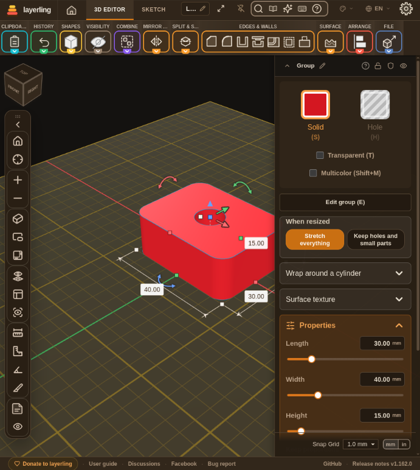

# layerling for Omarchy



[layerling](https://github.com/henmedia/layerling) is easy 3D CAD for 3D
printing: drop a shape, cut a hole, round an edge, export for the slicer. This
packages it as an Omarchy app: one window in the launcher, running
layerling's own server on this computer, so it works offline, keeps designs
in the app, and lets an AI client build parts with you.

## Install

```sh
bin/install
```

That builds the pinned layerling release (`pkgver` in `pkgbuild/PKGBUILD`)
and the window, and installs both with `makepkg -fsi`. The app then shows up
in the launcher (`Super + Space`) as **layerling**. It depends on `nodejs`
and `qt6-webengine`.

## How it works

- The window starts layerling's Next.js server on `127.0.0.1:47317` and shows
  it in a Qt WebEngine view. The port is fixed because designs live in the
  page's storage, which belongs to its address.
- Everything written goes in `~/.local/share/layerling`: browser storage
  (your designs), preview pictures, the MCP token, and exports in progress.
  The installed server in `/usr/lib/layerling` stays read-only.
- Exports go through the desktop's file chooser (xdg-desktop-portal) and are
  saved atomically; imports use the same chooser.
- Links out of the app open in your web browser.
- One copy runs per user: launching again, or `layerling open <url>`, opens
  the page in the running copy.
- The server stops with the app, even when the app is killed.

## Building parts with an AI

layerling ships an MCP server; the app switches its bridge on behind a
private token. Register it with Claude Code once:

```sh
claude mcp add --scope user layerling -- layerling mcp
layerling skill install
```

`layerling mcp` passes the address and token to the bridge, and when the
agent needs an editor it opens one in the app (starting it if needed), not in
a web browser. `layerling skill install` puts layerling's agent skill in
`~/.claude/skills`, with setup steps for this app.

## Keys

The editor owns the keyboard (Shift+F1 shows layerling's help, Ctrl+K its
command search). The window only takes Ctrl chords layerling leaves alone:

| Key | Action |
| --- | --- |
| Ctrl+Q | Quit |
| Ctrl+R | Reload the page (or retry starting the server) |
| Ctrl+= / Ctrl+- / Ctrl+0 | Zoom in, out, reset |
| Ctrl+W | Close an extra editor window |

## Commands

| Command | |
| --- | --- |
| `layerling` / `layerling open [url]` | Open the window, or one of layerling's pages |
| `layerling mcp` | MCP server over stdio for an AI client |
| `layerling skill install [--json]` | Install the agent skill |
| `layerling --version` | Version (the layerling release it ships) |

## Develop

```sh
bin/runtime   # once: fetch and build the pinned layerling server into build/runtime
bin/build     # the window, into build/layerling
bin/test      # tests, offscreen
```

`build/layerling` finds `build/runtime` beside it. `LAYERLING_DATA`,
`LAYERLING_RUNTIME`, and `LAYERLING_NODE` point it elsewhere.

To update layerling, change `pkgver` and `sha256sums` in `pkgbuild/PKGBUILD`,
then run `bin/install`.

## License

The window is MIT (see `LICENSE`). layerling is AGPL-3.0 and is built
unmodified from its release.
